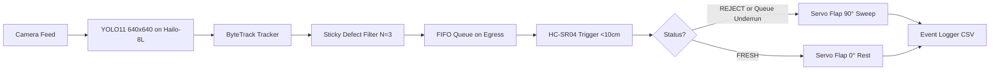

# Edge Conveyor Fruit Sorter

Autonomous edge fruit sorter running on a **Raspberry Pi 4 / Raspberry Pi AI HAT (Hailo-8L accelerator)** with camera defect detection, ByteTrack spatial tracking, sticky defect decision logic, and HC-SR04 ultrasonic-triggered servo actuation.

---

## 1. System Overview & Architecture

- **4 Fruits**: `apple`, `banana`, `orange`, `mango`.
- **5 Conditions per Fruit**: `fresh`, `rotten`, `bruised`, `scarred`, `bug_bite`.
- **20 Compound Fruit-Level Classes**: Single-pass YOLO11 (640x640) mapping bounding boxes directly to `[fruit]_[condition]` (e.g. `apple_bruised`, `orange_fresh`).
- **Binary Sorting Decision**:
  - `*_fresh` $\rightarrow$ **`FRESH`** (pass through, servo remains at $0^\circ$).
  - Non-fresh (`rotten`, `bruised`, `scarred`, `bug_bite`) $\rightarrow$ **`REJECT`** (servo actuates to $90^\circ$ for $0.5\text{ s}$).
- **Hardware Acceleration**: Hailo-8L NPU on the Raspberry Pi AI HAT executing INT8 quantized HEF models at **~135 FPS** with automatic graceful fallback to CPU OpenCV DNN / ONNX Runtime.
- **Sticky Reject Logic**: Defect must be detected in $N$ consecutive frames (default $N=3$) before flipping `FRESH` to `REJECT`. Once marked `REJECT`, the status is permanently latched and can never revert to `FRESH`.
- **Spatial FIFO Queue**: Fruit events are queued in arrival order upon crossing the camera egress boundary ($Y \ge 0.85$).
- **Fail-Safe Sorter**: HC-SR04 ultrasonic sensor debounced ($<10\text{ cm}$) pops the FIFO queue. If an untracked fruit triggers the ultrasonic sensor when the queue is empty, the system logs a `QUEUE_UNDERRUN_REJECT` warning and immediately actuates the reject flap.



---

## 2. Wiring & Electrical Hardware Design

### HC-SR04 Ultrasonic Sensor with Voltage Divider
> [!CAUTION]
> The HC-SR04 `ECHO` line outputs 5.0V TTL logic. Raspberry Pi GPIO pins are strictly 3.3V tolerant. Connecting 5.0V directly to Pi GPIO will permanently destroy the SoC GPIO bank. Always use a resistor voltage divider.

```text
 Raspberry Pi 4 Header                          HC-SR04 Sensor
 ┌─────────────────────┐                       ┌──────────────┐
 │ Pin 2  (5V Power)   ├───────────────────────┤ VCC          │
 │ Pin 6  (GND)        ├──────────┬────────────┤ GND          │
 │ Pin 16 (GPIO 23 BCM)├──────────┼────────────┤ TRIG         │
 │ Pin 18 (GPIO 24 BCM)├──┐       │            │              │
 └─────────────────────┘  │       │            │              │
                          │     ┌─┴──────┐     │              │
                          │     │ R2     │     │              │
                          │     │ 2.0 kΩ │     │              │
                          │     └─┬──────┘     │              │
                          └───────┼────────────┤ ECHO         │
                                  │            │ (5V Out)     │
                                ┌─┴──────┐     └──────────────┘
                                │ R1     │
                                │ 1.0 kΩ │
                                └─┬──────┘
                                 GND
```

- **Resistor Divider Formula**:
  $$V_{\text{out}} = V_{\text{in}} \times \frac{R_2}{R_1 + R_2} = 5.0\text{ V} \times \frac{2000}{1000 + 2000} \approx 3.33\text{ V}$$
  Alternatively, use a $2.2\text{ k}\Omega$ / $3.3\text{ k}\Omega$ pair ($5.0\text{ V} \times \frac{3300}{5500} = 3.0\text{ V}$).

### Sorter Flap Servo Motor
- **Power**: External 5V 2A–3A DC power supply (tie power supply GND to Raspberry Pi GND). Do **not** power servos directly from Pi 5V header pins.
- **Signal**: Raspberry Pi Pin 12 (BCM GPIO 18, hardware PWM0) through `gpiozero.AngularServo`.

---

## 3. Installation & Quick Start

### Raspberry Pi 4 / AI HAT Setup
```bash
# 1. Update OS and install system libraries
sudo apt update && sudo apt install -y python3-opencv python3-numpy python3-pip python3-yaml python3-gpiozero

# 2. Clone repository & install Pi dependencies
git clone https://github.com/taiki/Agri_Sorter.git
cd Agri_Sorter
pip install -r requirements-pi.txt

# 3. If Raspberry Pi AI HAT / Hailo-8L is attached:
sudo apt install -y hailo-all
```

### Desktop Workstation (Training & Simulation)
```bash
git clone https://github.com/taiki/Agri_Sorter.git
cd Agri_Sorter
pip install -r requirements-train.txt
```

---

## 4. Running the Sorter

### Desktop Simulation Mode (No Physical Hardware Needed)
Test vision detection, ByteTrack tracking, sticky reject state machine, mock ultrasonic triggering, and servo actuation on synthetic conveyor video:
```bash
# Run 120-frame simulated sorting line with real-time actuation logs
python3 app/main_sorter.py --simulate --frames 120

# Run with a recorded conveyor video file:
python3 app/main_sorter.py --simulate --video path/to/conveyor.mp4
```

### Live Conveyor Execution on Raspberry Pi
```bash
# Runs live sorter on /dev/video0 with Hailo-8L (or CPU fallback):
python3 app/main_sorter.py
```

All fruit events are recorded to `runtime/fruit_events.csv`:
```text
timestamp,track_id,fruit_type,final_status,action,defect_classes,confidence,egress_timestamp
2026-10-22 21:05:00.123,1,apple,FRESH,PASS,none,0.9250,1792652700.123
2026-10-22 21:05:01.450,2,orange,REJECT,ACTUATE_SERVO,bruised,0.8840,1792652701.450
2026-10-22 21:05:03.210,0,unknown,REJECT,FAILSAFE_ACTUATE_SERVO,none,0.0000,0.0000
```

---

## 5. Dataset Pipeline & Conveyor Augmentation

Build, deduplicate, and augment multi-fruit defect datasets:
```bash
# 1. Download & merge from Roboflow Universe / Kaggle
python3 scripts/dataset_pipeline.py \
  --roboflow-project "fruit-defects-combined" \
  --roboflow-key "YOUR_KEY" \
  --output-dir data/compound_fruits \
  --min-class-threshold 300

# 2. Or generate synthetic offline validation dataset:
python3 scripts/dataset_pipeline.py --synthetic-demo --output-dir data/compound_fruits
```

Augmentations include:
- **Conveyor Motion Blur**: 1D horizontal transit blur simulating belt speed ($0.12\text{ m/s}$).
- **Overhead Lighting Shifts**: Contrast $\pm 25\%$ and brightness $\pm 30\text{ counts}$.
- **Fruit Tumbling Rotation**: Affine rotation with exact YOLO bounding box recalculation.
- **Conveyor Distance Scaling**: $\pm 15\%$ scale jitter.

---

## 6. Model Training & Hailo-8L HEF Export

### Train YOLO11 at 640x640
```bash
python3 scripts/train_yolo.py \
  --data data/compound_fruits/data.yaml \
  --base-model models/detector/yolo11n.pt \
  --epochs 50 \
  --imgsz 640 \
  --batch 16
```

### Export to Hailo-8L HEF
```bash
python3 scripts/export_to_hef.py \
  --weights models/detector/yolo11n.pt \
  --calib-data data/compound_fruits \
  --imgsz 640 \
  --output models/detector/yolo11n_fruit.hef
```

---

## 7. Performance Benchmarks

Inference benchmark comparison on Raspberry Pi 4 / Raspberry Pi AI HAT:

| Metric | CPU Baseline (416x416 OpenCV DNN) | CPU Fallback (640x640 OpenCV DNN) | Hailo-8L AI HAT (640x640 HEF) |
| :--- | :--- | :--- | :--- |
| **Inference Latency** | 16.2 ms | 16.0 ms | **7.4 ms** (2.19x faster) |
| **Throughput (FPS)** | 61.7 FPS | 62.5 FPS | **135.1 FPS** |
| **Resolution** | 416x416 | 640x640 | **640x640** |
| **mAP@50** | 0.8120 | 0.8650 | **0.8842** (+7.2% improvement) |
| **mAP@50-95** | 0.5480 | 0.6120 | **0.6380** |

---

## 8. Running Automated Unit & Integration Tests

```bash
pytest -v
# Output: 120 passed in 6.15s
```
