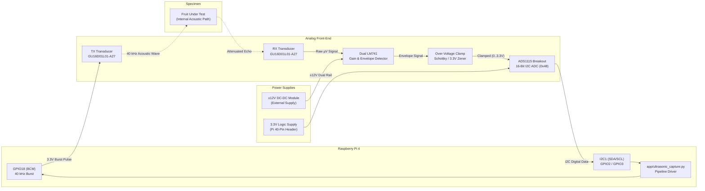

# Ultrasonic Hardware Integration & Interfacing Guide

This document details the hardware architecture, wiring connections, bill of materials (BOM), electrical safety analysis, and operating procedures for integrating 40 kHz ultrasonic transducers with the Raspberry Pi 4.

---

## 1. System Architecture

The ultrasonic subsystem measures the internal density, texture, and structural integrity of fruit by transmitting a 40 kHz acoustic burst through the specimen and capturing the attenuated echo arrival envelope.



---

## 2. Complete Wiring Table

All connections between the Raspberry Pi 4 (40-pin header), transducers, op-amp conditioning stages, and the ADS1115 ADC breakout are tabulated below:

| Net Name | From (Source) | To (Destination) | Function / Description |
| :--- | :--- | :--- | :--- |
| **TX_DRIVE** | Pi 4 Pin 12 (BCM GPIO18) | Transducer TX+ (GU16D01L01-A27) | 3.3V logic-level 40 kHz burst drive |
| **TX_GND** | Pi 4 Pin 6, 9, 14, or 20 (GND) | Transducer TX− | Transducer return ground |
| **RX_SIG** | Transducer RX+ (GU16D01L01-A27) | U1 (LM741) Pin 3 (Non-inverting input) | Weak acoustic echo voltage signal |
| **RX_GND** | Transducer RX− | Common Analog Ground (GND) | Shielded return ground |
| **AMP_V+** | PSU +12V Terminal | U1, U2 (LM741) Pin 7 (V+) | Positive dual supply rail for op-amps |
| **AMP_V-** | PSU −12V Terminal | U1, U2 (LM741) Pin 4 (V−) | Negative dual supply rail for op-amps |
| **AMP_GND**| PSU 0V / Common Ground | Pi Header GND & ADC GND | Common star ground point |
| **AMP_OUT**| U2 (LM741) Pin 6 (Output) | R_LIMIT (1 kΩ) series resistor | Conditioned analog envelope signal |
| **CLAMPED**| R_LIMIT output / Clamping node | U3 (ADS1115) Pin AIN0 | Over-voltage protected ADC input |
| **I2C_SDA** | Pi 4 Pin 3 (BCM GPIO2 / I2C1 SDA)| U3 (ADS1115) Pin SDA | 3.3V I2C serial data line (on-board pull-up) |
| **I2C_SCL** | Pi 4 Pin 5 (BCM GPIO3 / I2C1 SCL)| U3 (ADS1115) Pin SCL | 3.3V I2C serial clock line (on-board pull-up) |
| **ADC_VDD** | Pi 4 Pin 1 or 17 (3.3V Power) | U3 (ADS1115) Pin VDD | 3.3V DC digital and analog reference power |
| **ADC_GND** | Pi 4 Pin 9 or 25 (GND) | U3 (ADS1115) Pin GND | Ground reference |
| **ADC_ADDR**| U3 (ADS1115) Pin ADDR | U3 (ADS1115) Pin GND | Ties address to 0x48 (default) |

---

## 3. Bill of Materials (BOM)

| RefDes | Component | Specification | Quantity | Purpose / Notes |
| :--- | :--- | :--- | :--- | :--- |
| **TX1** | Ultrasonic Transducer | GU16D01L01-A27 (40 kHz, transmitter) | 1 | Acoustic burst emission |
| **RX1** | Ultrasonic Transducer | GU16D01L01-A27 (40 kHz, receiver) | 1 | Acoustic echo reception |
| **U1, U2** | Operational Amplifier | LM741CN or LM741CP (DIP-8) | 2 | Stage 1 pre-amplifier + Stage 2 envelope demodulator |
| **U3** | 16-Bit ADC Breakout | ADS1115 (Texas Instruments) | 1 | 860 SPS 16-bit analog-to-digital converter |
| **PS1** | Dual DC-DC Converter | Isolated ±12V DC-DC (e.g. B1212S or similar) | 1 | Powers dual-rail op-amps from single 5V/12V rail |
| **D_CLAMP**| Clamping Diode | BAT54S (Dual Schottky) or 1N5819 | 1 | Clamps ADC input to [GND − 0.3V, 3.3V + 0.3V] |
| **R_LIMIT**| Carbon Film Resistor | 1.0 kΩ, 1/4W, 5% | 1 | Current limiting resistor ahead of clamp diode |
| **R1, R2** | Gain Resistors | 1.0 kΩ / 100 kΩ (1% metal film) | 2 | Sets Stage 1 closed-loop gain (A_v ≈ 100) |
| **R3, C1** | Envelope Filter | 10 kΩ resistor, 0.1 µF film cap | 1 each | Diode detector / low-pass filter (fc ≈ 159 Hz) |
| **C_DEC** | Decoupling Capacitors | 0.1 µF ceramic + 10 µF tantalum | 4 | Decoupling on op-amp and ADC supply rails |

---

## 4. Electrical Safety & Protection Analysis

### 4.1 ADS1115 Input Over-Voltage Risk
- **The Danger**: The LM741 operational amplifiers run on dual **±12V** power supplies. Under saturation or ringing conditions, the op-amp output can swing up to approximately **+10.5V** or down to **−10.5V**.
- **The Limit**: The ADS1115 ADC has absolute maximum ratings:
  $$\text{Analog Input Voltage} \in [\text{GND} - 0.3\text{V}, \text{VDD} + 0.3\text{V}]$$
  When powered from the Pi's 3.3V rail, any voltage exceeding **3.6V** or falling below **−0.3V** will trigger the internal ESD diodes, causing latch-up, permanent gate oxide breakdown, or destruction of the ADS1115.

### 4.2 Protective Clamping Circuit
To eliminate this risk, an active clamping network is placed between the LM741 output and ADS1115 AIN0:
```text
  LM741 Output ───[ 1 kΩ R_LIMIT ]───┬───────────────> ADS1115 AIN0
                                     │
                                   ┌─┴─┐
                                   │ ▲ │ D_HIGH (Schottky to +3.3V)
                                   └─┬─┘
                                     ├───────────────> +3.3V Rail
                                     │
                                   ┌─┴─┐
                                   │ ▲ │ D_LOW (Schottky from GND)
                                   └─┬─┘
                                     │
                                    GND
```
1. **Series Resistor ($R_{\text{LIMIT}} = 1.0\text{ k}\Omega$)**: Limits fault current from the op-amp output during a rail-strike to:
   $$I_{\text{fault}} \le \frac{10.5\text{V} - 3.3\text{V}}{1.0\text{ k}\Omega} = 7.2\text{ mA}$$
   This is well within the continuous forward current capability of standard Schottky diodes.
2. **Schottky Diode (BAT54S or 1N5819)**: Forward drop $V_F \approx 0.25\text{V} - 0.35\text{V}$.
   - Positive transient clamped to: $3.3\text{V} + 0.30\text{V} = 3.60\text{V} \le V_{\text{max}}$.
   - Negative transient clamped to: $0\text{V} - 0.30\text{V} = -0.30\text{V} \ge V_{\text{min}}$.

### 4.3 Slew-Rate and Bandwidth Verification
- **LM741 Specifications**:
  - Gain-Bandwidth Product (GBWP): $1.0\text{ MHz}$
  - Typical Slew Rate: $SR = 0.5\text{ V}/\mu\text{s}$
- **40 kHz Signal Slew Demand**:
  For an envelope signal or $1\text{ V}_{\text{pp}}$ carrier ($V_{\text{peak}} = 0.5\text{V}$):
  $$\left.\frac{dV}{dt}\right|_{\max} = 2 \pi f V_{\text{peak}} = 2 \pi \times 40000 \times 0.5 \approx 0.126\text{ V}/\mu\text{s}$$
  Since $0.126\text{ V}/\mu\text{s} < 0.5\text{ V}/\mu\text{s}$, the LM741 maintains linear tracking for moderate-amplitude carrier bursts.
- **Envelope Demodulation**:
  After the half-wave diode rectifier, the envelope low-pass filter ($R = 10\text{ k}\Omega$, $C = 0.1\ \mu\text{F}$) has a cutoff frequency of:
  $$f_c = \frac{1}{2 \pi R C} = \frac{1}{2 \pi \times 10^4 \times 10^{-7}} \approx 159.1\text{ Hz}$$
  An envelope bandwidth of $\approx 160\text{ Hz}$ comfortably captures echo arrival times without slew-induced distortions.

---

## 5. Known Hardware Limitations

1. **ADS1115 Sample Rate Quantisation (860 SPS)**:
   - At its maximum conversion rate of 860 SPS, sample period $\Delta t \approx 1.16\text{ ms}$ ($1163\ \mu\text{s}$).
   - The ultrasonic time-of-flight difference between healthy and structurally damaged fruit is typically on the order of $100\ \mu\text{s} - 250\ \mu\text{s}$ (e.g. $4200\ \mu\text{s}$ vs $4375\ \mu\text{s}$).
   - *Mitigation*: The `RealReceiver` applies **sub-sample linear interpolation** across the threshold crossing to estimate fractional arrival time. For highest phase resolution in future iterations, an external hardware comparator or high-speed MCU ADC is recommended.
2. **Linux User-Space Software Bit-Bang Jitter**:
   - `RealTransmitter` drives GPIO18 via tight loops with `time.perf_counter_ns()`. Under Linux OS scheduling and CPU frequency scaling, software jitter ranges between $\pm 5\ \mu\text{s}$ and $\pm 20\ \mu\text{s}$.
   - *Mitigation*: Envelope detection measures relative threshold crossing and peak amplitude, which is resilient against small transmit jitter.
3. **Op-Amp Noise Floor**:
   - Standard LM741 op-amps exhibit an input noise voltage density of $\sim 20\text{ nV}/\sqrt{\text{Hz}}$. For fine density characterization, modern low-noise rail-to-rail op-amps (such as OPA340 or TLV2372) offer improved dynamic range.
4. **Ultrasonic Feature Logging**:
   - The ultrasonic hardware directly captures 2 core features (`travel_time_us`, `received_amplitude`) and can record auxiliary measurements (`fruit_diameter_mm`, `weight_g`, `temperature_c`).
   - YOLO alone determines fresh vs defective quality classification at the conveyor level.

---

## 6. Pre-Flight Bench-Check Checklist

Perform these hardware checks prior to automated conveyor operation:

- [ ] **Power Rail Verification**: With transducers disconnected, measure $+12\text{V} \pm 0.5\text{V}$ on Pin 7 of U1/U2 and $-12\text{V} \pm 0.5\text{V}$ on Pin 4.
- [ ] **Common Ground**: Verify continuity between Pi GND, PSU GND, and ADC GND ($R < 0.2\ \Omega$).
- [ ] **I2C Bus Discovery**: Run `i2cdetect -y 1` on the Raspberry Pi. Confirm address `0x48` is listed.
- [ ] **Transducer Drive Pulse**: Connect oscilloscope probe to TX+ (GPIO18). Execute single pulse and verify an 8-cycle 40 kHz square wave ($25\ \mu\text{s}$ period, 3.3V amplitude).
- [ ] **Clamp Protection Verification**: Inject a test +5V through $R_{\text{LIMIT}}$ and confirm voltage at ADS1115 AIN0 does not exceed $3.4\text{V}$.
- [ ] **Quiescent Noise Floor**: Run `app/ultrasonic_capture.py --count 10` with no fruit. Confirm raw ADC reading remains well below configured `envelope_threshold` (200 counts).
- [ ] **Known Specimen Echo**: Place a reference apple in the acoustic fixture. Run capture and verify `travel_time_us` falls between $3800\ \mu\text{s}$ and $4800\ \mu\text{s}$ with distinct peak amplitude.

---

## 7. Execution & Operating Commands

### Simulation / Mock Mode (Development Workstation)
```bash
# Capture 5 mock measurements to stdout
python3 -m app.ultrasonic_capture --mock --count 5

# Capture 100 mock measurements with auxiliary fruit attributes to CSV
python3 -m app.ultrasonic_capture --mock --count 100 \
    --diameter 74.0 --weight 180.0 --temperature 25.1 \
    --csv-out data/internal/measurements.csv
```

### Raspberry Pi 4 Target Deployment (Live Hardware)
```bash
# 1. Ensure required system packages and permissions
sudo apt-get install -y python3-gpiod i2c-tools
pip install adafruit-circuitpython-ads1x15 adafruit-blinka

# 2. Verify I2C interface
i2cdetect -y 1

# 3. Execute live data capture from hardware
python3 -m app.ultrasonic_capture \
    --config config/hardware.toml \
    --count 50 \
    --delay 0.2 \
    --diameter 75.0 \
    --weight 185.0 \
    --temperature 24.5 \
    --csv-out data/internal/session_01.csv

# 4. Execute ultrasonic batch capture
python3 -m app.ultrasonic_capture \
    --config config/hardware.toml \
    --count 10 \
    --csv-out data/internal/readings.csv
```
